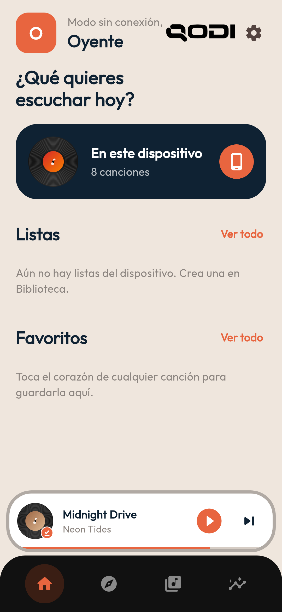
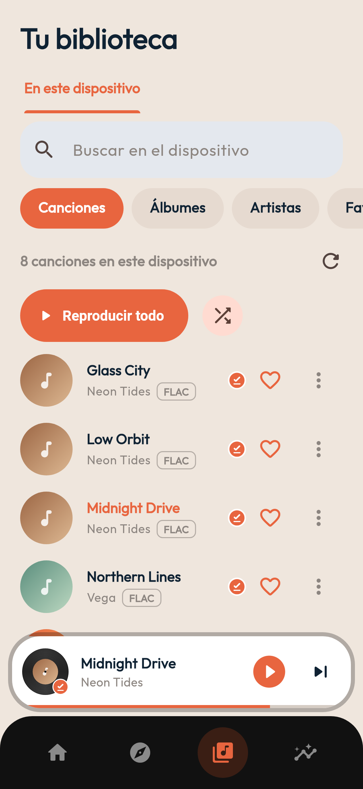
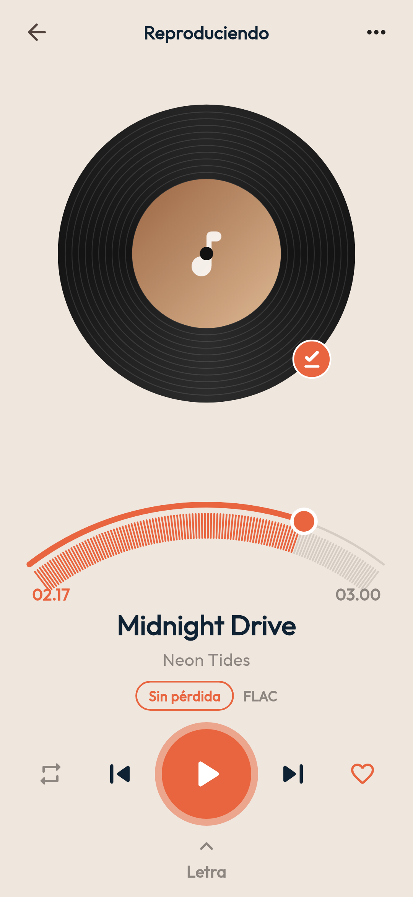
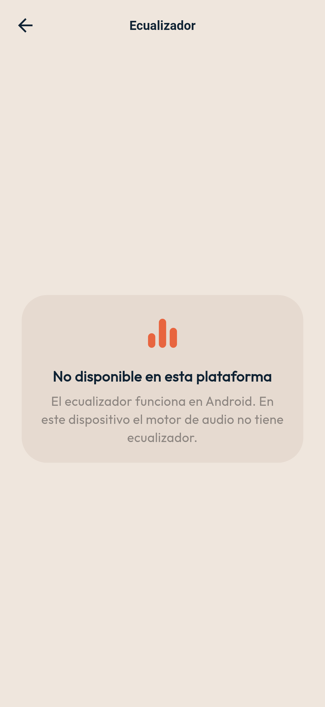
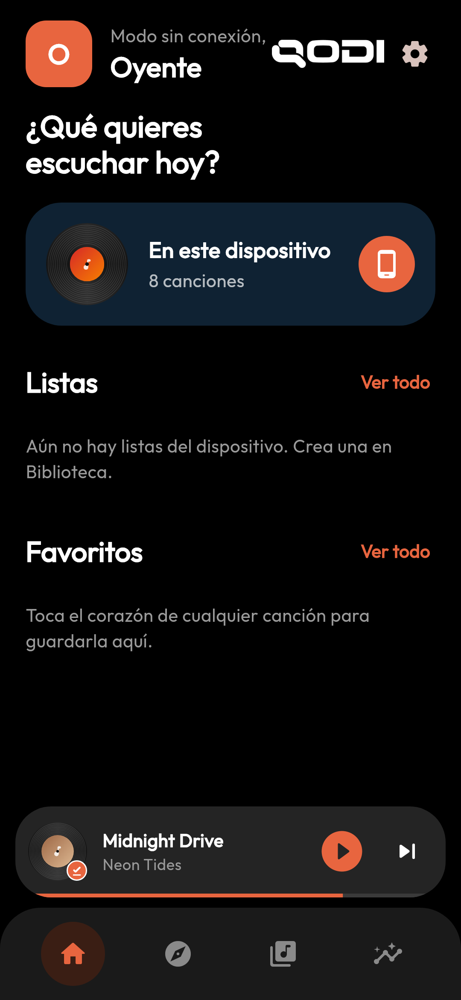
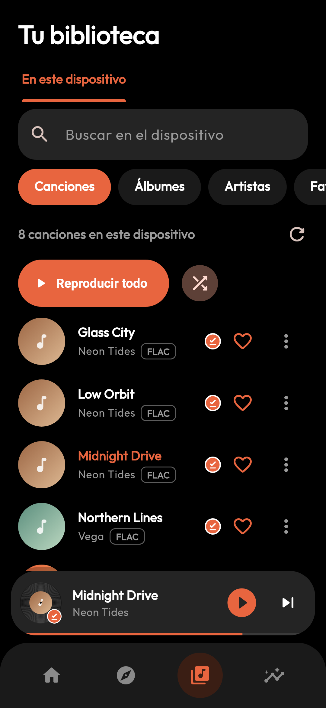
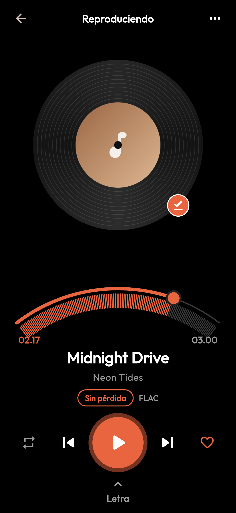
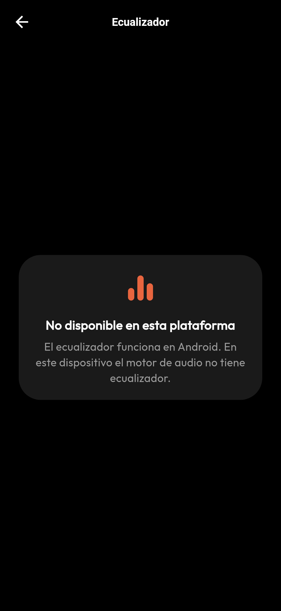
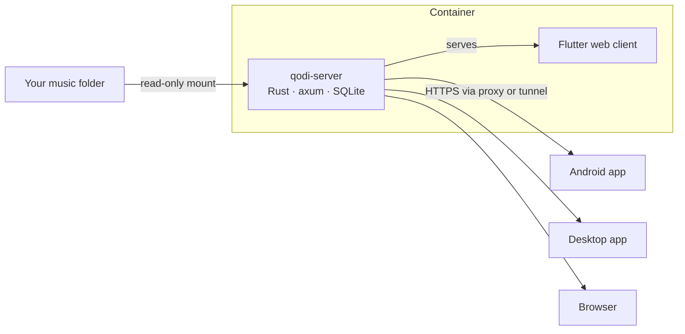

<div align="center">

<picture>
  <source media="(prefers-color-scheme: dark)" srcset="docs/brand/logo_white.png">
  
</picture>

**Your own music, streamed from your own server.**

A self-hosted music streaming system: a fast Rust server that indexes and streams your library,
and a Flutter client for Android, web and desktop that also plays offline.

[](https://github.com/cbranty/qodi-music/actions/workflows/ci-cd.yml)
[](LICENSE)


[Quick start](#quick-start) · [How it works](#how-it-works) · [Deployment](#deployment) · [Configuration](#configuration) · [Clients](#clients) · [Contributing](CONTRIBUTING.md)

</div>

---

## Features

| | |
|---|---|
| 🎧 **Streaming** | Original files with HTTP Range, or on-the-fly Opus 128 kbps (cached) to save data |
| 📴 **Offline** | Download songs, albums and playlists; play music stored on the device, with or without a server |
| 💎 **Audio quality** | Format, bitrate, sample rate and bit depth per track, with *Lossless* and *Hi-Res* badges |
| 🗂️ **Library** | Automatic scan of your folder (tags, embedded or folder covers, `.lrc` lyrics) with live file watching |
| ❤️ **Personal** | Playlists, favorites, listening stats and synced lyrics, per user |
| 👥 **Invite-only accounts** | Admin creates invite codes; no open sign-up |
| 🎚️ **Equalizer** | Presets and per-band gains (Android) |
| 🔄 **Android self-update** | CI publishes a signed APK on your server; the app updates itself |
| 🌍 **Languages** | English and Spanish, following the device language |
| 📦 **One container** | Server + web client in a single Docker image, ~one command to deploy |

## Screenshots

| Home | Library | Now playing | Equalizer |
|:---:|:---:|:---:|:---:|
|  |  |  |  |
|  |  |  |  |

Regenerate with `cd app && flutter test screenshots --update-goldens` (device-only mode with sample songs).

## Quick start

You need Docker with Compose and a folder of music.

```bash
git clone https://github.com/cbranty/qodi-music.git
cd qodi-music
cp .env.example .env        # set QODI_ADMIN_USER, QODI_ADMIN_PASSWORD and QODI_MUSIC_DIR
docker compose up -d
curl http://localhost:4040/api/v1/health    # → {"status":"ok","version":"…"}
```

Open `http://localhost:4040` and sign in with the admin account. The first scan runs in the
background, so tracks appear within seconds to minutes depending on the size of your library.

> [!TIP]
> To build the image yourself instead of pulling it from GHCR:
> `docker compose -f docker-compose.yml -f docker-compose.build.yml up -d --build`

## How it works



1. **Scan.** The server walks the music folder, reads tags and audio properties
   (`lofty`), and stores them in SQLite. A file watcher plus a periodic rescan keep it in
   sync; only new or changed files are read again.
2. **Stream.** Clients request `/api/v1/tracks/{id}/stream`. The server sends the original
   file with Range support, or transcodes it to Opus with `ffmpeg` and caches the result.
3. **Sync.** Clients keep a local copy of the library and fetch only the changes
   (`/library/changes`), so browsing works offline. Downloaded tracks play from disk.
4. **Authenticate.** Users sign in with a password (Argon2) and receive a JWT. New users
   join with an invite code created by an admin.

The full HTTP contract is in [`docs/api.md`](docs/api.md).

| Component | Stack |
|---|---|
| Server | Rust, axum, tokio, sqlx (SQLite), lofty, symphonia, ffmpeg |
| Client | Flutter, Riverpod, go_router, just_audio + audio_service, drift |
| Delivery | Docker, GitHub Actions, GitHub Container Registry |

## Deployment

### Docker Compose (any Linux server)

The [Quick start](#quick-start) is a complete production setup. Keep in mind:

- The music folder is mounted **read-only**. The database, transcode cache and generated
  JWT secret live in the `qodi-data` volume — **back it up**.
- The container runs as `QODI_UID:QODI_GID` (default `1000:1000`). That user must be able
  to read the music folder.
- **Update:** `docker compose pull && docker compose up -d`.
  **Roll back:** set `QODI_TAG=sha-<commit>` in `.env` and run the same command.

### Exposing it to the internet

Put the server behind HTTPS. Any reverse proxy works; point it at port `4040`.

<details>
<summary><b>Caddy</b></summary>

```caddyfile
music.example.com {
    reverse_proxy localhost:4040
}
```
</details>

<details>
<summary><b>Cloudflare Tunnel</b></summary>

Route a hostname such as `music.example.com` to `http://localhost:4040` (or to the
container on its Docker network). Do **not** put Cloudflare Access in front of it: the
mobile app cannot complete the Access login. Add a rate-limiting rule for
`/api/v1/auth/login` instead.
</details>

If only the proxy or tunnel should reach the server, remove the `ports:` mapping from
`docker-compose.yml`.

### Dokploy

1. Create a **Compose** service from this repository (compose path `docker-compose.yml`).
2. Add the variables from `.env.example` to the service environment.
3. In **Domains**, map your hostname to service `qodi-music`, port `4040`.
4. Optional: enable **Autodeploy** and store the service's deploy webhook as the
   `DOKPLOY_WEBHOOK_URL` repository secret, so every push to `main` redeploys
   (see [CI/CD](#cicd-for-your-fork)).

### Adding music

Anything that puts files into `QODI_MUSIC_DIR` works: `rsync`, `scp`, a network share, or
[Syncthing](https://syncthing.net) between your computer and the server. New files are picked
up automatically.

- Tag files (title, artist, album, cover) with [MusicBrainz Picard](https://picard.musicbrainz.org) or [Kid3](https://kid3.kde.org).
- Put synced lyrics next to the audio as `<same-name>.lrc`.
- Supported files: `.flac`, `.mp3`, `.m4a` (AAC/ALAC), `.aac`, `.opus`, `.ogg` and `.wav`.

## Configuration

Set these in `.env` (Compose) or in your platform's environment.

| Variable | Default | Description |
|---|---|---|
| `QODI_ADMIN_USER` | — *(required)* | Admin account, created on first start and kept admin on every start |
| `QODI_ADMIN_PASSWORD` | — *(required)* | Initial admin password. Never re-applied to an existing user |
| `QODI_MUSIC_DIR` | `./music` | Host folder with your library, mounted read-only at `/music` |
| `QODI_JWT_SECRET` | generated | Token signing secret. Leave empty to generate and persist a random one |
| `QODI_TOKEN_TTL_DAYS` | `30` | Session lifetime |
| `QODI_SCAN_INTERVAL_SECS` | `3600` | Periodic full rescan, in addition to the file watcher |
| `QODI_PORT` | `4040` | Host port |
| `QODI_UID` / `QODI_GID` | `1000` | User and group the container runs as |
| `QODI_TAG` | `latest` | Image tag to run (`latest`, `sha-<commit>` or `X.Y.Z`) |
| `RUST_LOG` | `info` | Log level |

Paths inside the container (`QODI_DATA_DIR`, `QODI_WEB_DIR`, `QODI_DIST_DIR`, `QODI_BIND`)
are documented in [`docs/api.md`](docs/api.md) and rarely need changes.

## Clients

| Platform | How to get it | Notes |
|---|---|---|
| **Web** | Open your server URL | Served by the same container |
| **Android** | `https://<your-server>/downloads/android/qodi-music.apk` | Published by CI; updates itself afterwards |
| **Linux** | `cd app && flutter build linux --release` | Needs `libmpv` |
| **Windows / macOS / iOS** | `flutter build <platform>` | Scaffolded, less tested |

On first launch, enter your server URL, username and password, or choose
**Use without server** to play only music stored on the device.

### Inviting people

As admin, open **Settings → Users & invites → Create invite**. Share the join link
(`<server>/join?code=…`) and the APK link. Codes expire (1–720 hours) and have a use limit
(1–50).

## CI/CD for your fork

Every push to `main` runs [`.github/workflows/ci-cd.yml`](.github/workflows/ci-cd.yml):

```
Server tests ─┐
App tests ────┼─► Signed APK ─► Docker image → ghcr.io/<owner>/qodi-music ─► Dokploy webhook
```

Pull requests run only the test jobs and never see secrets.

| Repository secret | Needed for | How to create it |
|---|---|---|
| `ANDROID_KEYSTORE_BASE64` | Signed APK | `base64 -w0 qodi-music.jks` |
| `ANDROID_KEYSTORE_PASSWORD` | Signed APK | The password you chose for the keystore |
| `ANDROID_KEY_ALIAS` | Signed APK | The alias you chose (for example `qodi`) |
| `DOKPLOY_WEBHOOK_URL` | Auto-deploy (optional) | The deploy webhook URL of your Dokploy service |

Create your own signing key once and **keep a backup**: Android only installs updates
signed with the same key.

```bash
keytool -genkeypair -v -keystore qodi-music.jks -alias qodi \
  -keyalg RSA -keysize 4096 -validity 10000
```

If your GHCR package is private, give the server a token with `read:packages`
(`docker login ghcr.io`, or Dokploy → *Settings → Registry*).

## Project structure

```
qodi-music/
├── server/        Rust server — hexagonal modules: library, streaming, auth, adapters, http
├── app/           Flutter client — feature folders with domain / data / ui layers
├── docs/api.md    HTTP API contract shared by server and client
├── Dockerfile     Multi-stage: Flutter web build → Rust build → slim runtime with ffmpeg
└── docker-compose.yml
```

More detail: [`server/README.md`](server/README.md) · [`app/README.md`](app/README.md)

## Development

```bash
# Server
cd server && cargo test && cargo clippy --all-targets -- -D warnings

# Client
cd app && flutter pub get && flutter analyze && flutter test
```

See [CONTRIBUTING.md](CONTRIBUTING.md) for the workflow and [SECURITY.md](SECURITY.md) to
report vulnerabilities.

## License

The source code is released under the [MIT License](LICENSE): you can use, modify and
redistribute it, including commercially, as long as you keep the copyright notice.

The **Qodi** name and logo (`docs/brand/`, `app/assets/brand/`, app icons) identify this
project and are not covered by the MIT License. If you publish a modified version, please use
your own name and icon.

Qodi Music is for music you own or have the right to stream. You are responsible for the
content you host.
